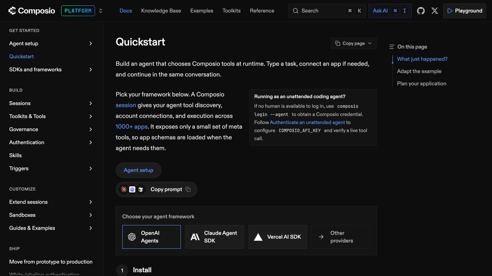

# OAuth Atlas — Documentation workspace

Updated 30 October 2026. OAuth Atlas is an independent submission prototype. Its primary design reference is Composio's documentation UI, rather than the public marketing directory.

## Primary reference and measured evidence

[Composio quickstart](https://docs.composio.dev/docs/quickstart) was inspected directly in the browser. The page uses a fixed top bar, grouped navigation on the left, a focused article, and an on-page contents list on the right. The inspected heading was **28px / weight 500**; paragraph text was **16px with 28px line spacing**. The inspected article measured approximately 743px wide and the left sidebar approximately 269px. These are observations at the captured viewport, not universal source breakpoints.

The [authentication documentation](https://docs.composio.dev/docs/authentication) and [managed/custom auth guide](https://docs.composio.dev/docs/authentication/custom-app-vs-managed-app) remain the terminology references for provider OAuth app, auth config, Connect Link and connected account.

## Correction to the earlier design

The previous revision copied the visual language of the homepage and public OAuth directory. Subject similarity was mistaken for workflow fit. Oversized headings, promotional space and small display metadata made the working guide harder to read. That treatment is superseded; the original captures remain in `docs/references/` as historical evidence, not implementation targets.

D14 in the decision log records the earlier assumption, the correction and its limits. This change does not claim measured usability gains or authenticated-dashboard fidelity.

## Implemented layout

- **Top bar:** persistent identity, a global guide/page search with Cmd/Ctrl+K, and a research action.
- **Left navigation:** grouped provider links, saved guides, research notes, the decision log and source references. A mobile drawer preserves the same navigation.
- **Catalog:** compact heading, a managed-auth prompt, immediate search/filter controls, and comparable launch effort/wait fields. There is no promotional hero.
- **Reading pages:** a focused column with 28px page headings and 16px/28px primary reading text. Guides have continuous anchored sections rather than hidden content tabs.
- **On-page navigation:** a sticky right outline on wide screens and a compact section disclosure on smaller screens.
- **Decision log:** readable single-column explanations, objective rows and requirement disclosures replace the wide prose matrix and split-column rationale.
- **Research/sharing:** compact dialogs with normal-case labels, readable inputs, actual progress and explicit failure states.

## Tokens and adaptations

| Role | Value / approach | Basis |
| --- | --- | --- |
| Page background | `#0c0c0d` | Adaptation of observed dark docs theme |
| Sidebar | `#101011` | Implementation choice |
| Main text | `#ededf0` | Readability choice |
| Reading text | 16px / 28px | Matches inspected reference values |
| Main heading | 28px / 36px, weight 550 | Reference-derived; 550 is an adaptation |
| Section heading | 22px / 31px | Proposed hierarchy |
| Metadata and navigation | 11–14px | Secondary hierarchy, distinct from reading text |
| Accent | `#85a4ff` with restrained blue surfaces | Approximation of docs links/active states |
| Borders | `#28282c` | Implementation choice |
| Typography | Geist with system fallback; mono for code/IDs | Existing brand-aligned family retained |
| Corners | 4–7px on controls/callouts | Adapted documentation controls |
| Sidebar width | 248px; 264px on large screens | Adaptation of observed 269px sidebar |
| Reading column | Up to 760px | Adaptation of observed article width |

## Quality criteria

Verify that the catalog exposes search without scrolling through a hero; guide and decision body text stays at 16px/28px; navigation remains available while scrolling; section anchors preserve guide state; the research and share flows still work; and the page has no horizontal overflow on narrow screens. These checks establish implementation behavior, not user preference or task-completion performance.

## Advisor workflow extension

The later MVP brief makes a contextual assessment the primary workflow. The same docs shell now contains a restrained use-case input, three provider entry points, editable capability suggestions, a two-part contextual form and a recommendation article with a desktop section outline. The entry heading is 33px on desktop and 28px on narrow screens; recommendation headings retain the 28px reading hierarchy. Primary explanations, checklist details and permission descriptions use 16px/28px text.

The provider directory distinguishes rule-backed assessments from catalog-only names. Unknown metadata is visible beside each catalog row rather than hidden behind a generic verified badge. The recommendation separates the app model, managed-method availability, permission fit, conditional launch dependencies, personal checkmarks and actual provider outcomes.

Sharing explicitly includes assessment answers. A portable URL recomputes with current rules; Markdown captures the current plan. No approval score, fictitious elapsed time or account-connection status is used to decorate the result.
