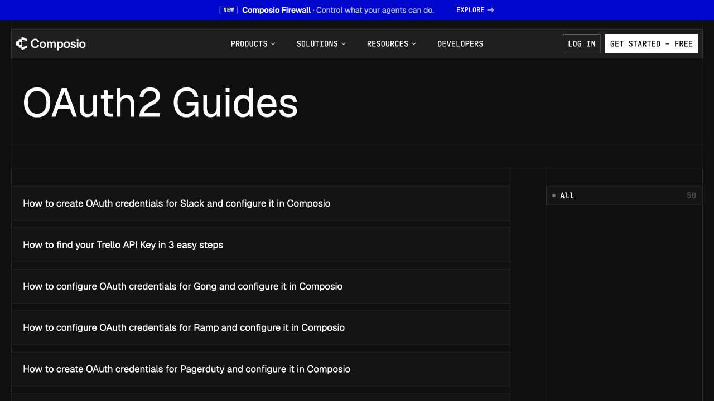
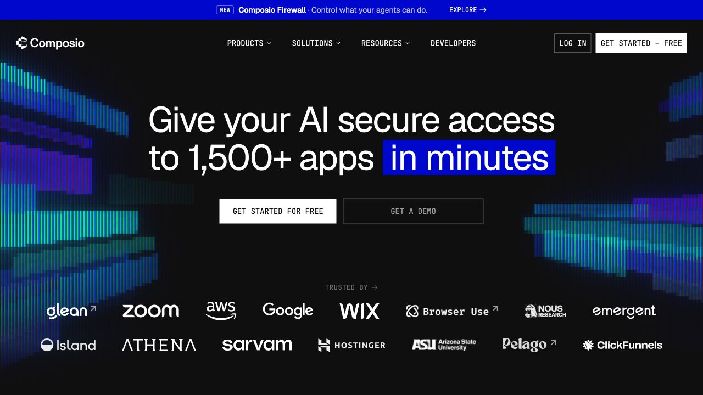

# OAuth Atlas — Composio design reference

Captured 29 October 2026. This is an independent submission prototype using Composio's visual language, not an official Composio page.

## Sources and inspected evidence

- [Composio homepage](https://composio.dev/): browser screenshot and DOM-backed computed styles.
- [OAuth2 Guides](https://composio.dev/auth): browser screenshot, layout, headings, links, computed type and card styles.
- [Developer platform](https://composio.dev/developers): product language and OAuth/token-refresh description.
- [Managed OAuth apps](https://docs.composio.dev/toolkits/managed-auth), [managed vs custom auth](https://docs.composio.dev/docs/authentication/custom-app-vs-managed-app), [authentication](https://docs.composio.dev/docs/authentication): entity names and flow.

Firecrawl branding/screenshot capture was attempted but anonymous access was unavailable. Screenshots and measured values below come from direct browser inspection; missing measurements are marked as design choices.

## Observed system

- Both the homepage hero and OAuth directory use an almost-black surface, white text, fine dark grid borders and low-radius or square controls. The site's body CSS also declares a light `#f6f6f6` canvas for other sections; the OAuth reference itself is dark.
- Geist Sans is the observed body and heading family. The homepage heading is 64px/69.12px at weight 400 with -1.6px tracking; the OAuth directory heading is 72px, weight 400 at the inspected desktop viewport.
- Navigation/CTA type is JetBrains Mono, 14px on inspected homepage buttons. Primary homepage buttons are white with black text and 0px radius. The OAuth directory uses spacious horizontal rows and a right-hand category rail.
- A saturated blue announcement bar, uppercase mono labels, plain action verbs and explicit developer concepts create the recognizable contrast. The exact source blue and all spacing were not measured; implementation approximations follow.

## Implementation tokens

| Role | Value | Basis |
| --- | --- | --- |
| Base | `#0f0f0f` | Observed dark-surface approximation |
| Raised surface | `#171717` | Implementation choice, consistent with observed layering |
| Main text | `#f5f5f5` | Implementation choice matching observed white text |
| Muted text | `#a3a3a3` | Readability choice for the dense guide UI |
| Border | `#2c2c2c` | Observed button-border color; reused for rails |
| Accent | `#1600ff` | Visual approximation of reference blue |
| Primary action | White background, black text | Observed |
| Corners | 0–2px | Observed 0px primary controls; 2px is a UI-specific choice |
| Fonts | Geist + JetBrains Mono, system fallbacks | Observed families; Google Fonts distribution used by prototype |
| Container | 1240px with 24px outer gutters | Implementation choice from visible reference proportions |
| Spacing | 4, 8, 12, 16, 24, 32, 48, 64px | Proposed reusable scale |

## Apply across the product

Use a blue context strip, a dark horizontal brand/navigation bar, bordered page rails and a large left-aligned title. Remove the persistent mint workspace sidebar and decorative rotated cards. Keep dense comparison rows because effort and waiting time are core assignment decisions. On small screens retain those fields in stacked rows.

Use the same dark surfaces, square buttons, readable copy and mono metadata on guide tabs, checklists, blocker disclosures, evidence notebooks, dialogs, empty/error/loading states, saved guides, product notes, and the new decision log. Status colors communicate evidence or dependencies, not decoration. Use explicit text labels alongside colors.

## Product language

Use provider OAuth app for provider registration, auth config for the toolkit's authentication blueprint, and connected account for one user's grant. Managed auth may avoid registration; custom auth uses the developer's own app. A provider redirect URI differs from the application callback after a Connect Link. Do not suggest that this prototype creates an auth config or connects accounts.

## Fidelity boundary

This mirrors the observed visual system and vocabulary while retaining OAuth Atlas's identity. It does not copy Composio's logo, marketing animations, customer claims, account access or product capabilities. Mobile layouts and hover/focus states are implementation choices, not measured source behavior.
