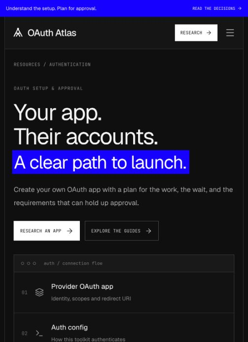

# OAuth Launch Advisor

**[Working experience](https://oauth-atlas.mossystar19.chatgpt.site) · [Source repository](https://github.com/infiniym/oauth-atlas)**

Describe an integration, confirm its requirements, and get an authentication architecture, permission map and launch checklist. The core works without API keys or signing into a provider.

The local app now uses one launch-plan experience for reviewed and unfamiliar providers. Gmail, Slack and GitHub use reviewed rules; other apps use public documentation research. Both feed the same plan contract, application shell, first-test/launch sections and sharing controls. A provider does not need to be in the directory. See [live research and setup](docs/LIVE-GUIDE.md).

Intake and research share the selected Anthropic key/model. Local Haiku 5.5 runs use adaptive thinking at medium effort. Real checks include Gmail intake, Linear app actors, Notion read-only capabilities, Asana task access and a public API without OAuth. See [the current evaluation](docs/evaluations/UNIFIED-2026-10-31.md). Earlier failures and limits remain recorded in [the initial Haiku evaluation](docs/evaluations/HAIKU-2026-10-31.md).

This revision is in the combined local checkout. The hosted link and screenshot below are from the earlier deployment; they have not been refreshed.



## Try it

1. Enter “An AI assistant that reads Gmail messages and drafts replies for customers,” or choose Gmail, Slack or GitHub.
2. Confirm actions and the required setup choices on one screen. Questions that cannot change the path are omitted; customer policy checks become tasks. The original request stays read-only until **Change request** reruns and previews suggestions.
3. Create the plan. Read the hands-on setup estimate and separately sourced review guidance, then inspect reasoning, permissions, conditional dependencies and the checklist. Estimates are scoped planning ranges, not timed results or a launch date.
4. Edit Gmail to **send only** and regenerate. Restricted scopes and the restricted-data assessment dependency disappear; sensitive-scope guidance remains where applicable.
5. Use the Slack or GitHub example prompts, then confirm their actual requirements. A limited Slack pilot differs from commercial distribution; selected-repository background work leads to a GitHub App and a separate installation flow.
6. Copy, download Markdown or share the plan. Share saves a dated version of output and inputs; reopening it does not rerun the current rules. Editing creates a new version. Personal checkmarks are excluded.
7. Search the **Provider directory**, or select **Research an app** for an unfamiliar provider.

## Coverage and evidence

| Coverage | What it means |
| --- | --- |
| 3 deep assessments | Gmail, Slack and GitHub, with source-backed rules for the listed actions and contexts |
| 1,694 catalog entries | Real toolkit names and Composio documentation links, captured 30 October 2026; catalog-only auth methods and managed availability are unverified |
| 4 setup reference guides | Earlier researched GitHub, Notion, Slack and Gmail guides, including setup observations and corrections |
| Live research plans | Bounded discovery, action/permission research and interpretation; gaps stay explicit and provider execution remains untested |

The intended 100 reviewed OAuth-guide library is **not complete**. Catalog breadth is not validated-guide breadth. [Open an existing hosted Linear research draft](https://oauth-atlas.mossystar19.chatgpt.site/?guide=draft-f9ad563b-6fd1-4644-9fdf-22237134d1f9).

The advisor checks official provider and Composio documentation. It has not registered apps, exchanged OAuth tokens, executed customer tools or obtained approvals. Previous setup observations reached public sign-in gates and inspected Google's client creation form without submission. The advisor adds planning depth, not an approval certification.

## Run locally

Node **22.13+**, npm. No API keys or cloud/provider accounts required.

```sh
npm ci
npm run build
node --import ./scripts/sites-env.mjs ./node_modules/wrangler/bin/wrangler.js d1 execute DB --local --config dist/server/wrangler.json --persist-to .wrangler/state --file drizzle/0000_orange_wallop.sql
node --import ./scripts/sites-env.mjs ./node_modules/wrangler/bin/wrangler.js d1 execute DB --local --config dist/server/wrangler.json --persist-to .wrangler/state --file drizzle/0001_groovy_mister_fear.sql
node --import ./scripts/sites-env.mjs ./node_modules/wrangler/bin/wrangler.js d1 execute DB --local --config dist/server/wrangler.json --persist-to .wrangler/state --file drizzle/0002_romantic_lockheed.sql
npm run dev -- --port 5173
```

Open `http://localhost:5173`. Apply the migration once per fresh local database. Local and hosted D1 stores are separate. The advisor uses browser-local drafts and checkmarks; D1 stores public research versions, explicitly shared reviewed plans and anonymous rate limits.

```sh
npm test
npm run typecheck
npm run build
```

## Deterministic rules versus AI

**Deterministic:** typed capability mappings, app-model selection, managed/custom suitability, permission classification, conditional dependencies, explanation IDs, checklist and export. Rules include source IDs and check dates. Tool restrictions are kept separate from provider grants. Managed OAuth availability never proves the necessary scope/token fit.

**Optional AI:** the server-side Anthropic Messages or OpenAI Responses structured-output adapter interprets the use-case description into known capabilities and unresolved questions. It cannot supply new scopes or approval rules. Model output is schema-validated and always editable. No key, invalid output, refusal, rate limit or timeout preserves the structured workflow with labeled local keyword suggestions.

**Live research:** `/live-guide` performs public discovery and reads up to eight content pages plus one targeted follow-up of up to three pages. The shared Anthropic configuration enables structured interpretation with checked source excerpts, exact permission identifiers, documented destinations and action coverage. Without it, evidence-only findings remain explicit about unresolved timing, permissions and approvals. The older four-page `/api/research` reader remains available for compatibility.

## Optional configuration

The local preview has exercised real Haiku calls; hosted settings have not been updated. Authenticated Composio metadata and credentialed Firecrawl retrieval remain unverified. No API key is required for reviewed rules or basic source collection.

| Server-side binding | Behavior |
| --- | --- |
| `AI_PROVIDER` | Select `anthropic`, `openai`, or `none` (local suggestions only). If omitted, exactly one complete key/model pair is selected; two complete pairs require an explicit selection. |
| `ANTHROPIC_API_KEY` + `ANTHROPIC_MODEL` | Enable intake and live research using the same Anthropic model. Supply an exact model ID with adaptive thinking and structured-output support. No model is silently selected. |
| `OPENAI_API_KEY` + `OPENAI_MODEL` | Optional alternative for intent interpretation. Choose a model in your account supporting Responses structured outputs; no model is silently selected. `store: false`; input is the developer's description and a constrained capability map. |
| `COMPOSIO_API_KEY` | Read `/api/v3.1/toolkits/{slug}` metadata for the selected assessment/Slackbot variant. Checks exact `composio_managed_auth_schemes`; does not infer granted scope coverage. |

For Anthropic, the server-side configuration is:

```dotenv
AI_PROVIDER=anthropic
ANTHROPIC_API_KEY=your_key_in_the_ignored_local_file
ANTHROPIC_MODEL=claude-haiku-5-5
```

The adapter calls Anthropic directly with a fixed capability schema via `output_config.format` and API version `2026-10-21`. It accepts complete message responses only, then checks the known provider/capability mapping locally. Intake has a 25-second deadline and 4,096-token bound, with adaptive thinking at medium effort. Live research has separate task budgets using the same model: see [the bounded workflow](docs/LIVE-GUIDE.md). Refusal, truncation, unsupported output, timeout or an API error returns local suggestions. It never silently sends the description to another vendor. See [Anthropic structured outputs](https://platform.claude.com/docs/en/build-with-claude/structured-outputs) and [Messages API version migration](https://platform.claude.com/docs/en/api/migration-2026-10-21).

For Vite/Cloudflare development, copy [.dev.vars.example](.dev.vars.example) to an ignored `.dev.vars` and provide server-side values using Cloudflare's local bindings facility. Configure equivalent Worker runtime secrets for hosting. Never put these values in client bundles or `NEXT_PUBLIC_` variables. Missing/failed metadata retains the dated docs snapshot instead of declaring managed OAuth unavailable. Restart the local server after changing bindings. Optional AI has an anonymous limit of 20 requests per connection/hour; live research has a limit of 12.

## Architecture

React + TypeScript on the existing Vinext/Vite stack, hosted as a Cloudflare Worker through Sites. No framework replacement or new account system.

| Module | Responsibility |
| --- | --- |
| `components/advisor.tsx` | Discovery, assessment, recommendation, checklist, edit/share/export |
| `lib/advisor/types.ts`, `providers.ts` | Typed requirements, capabilities, official sources and dated metadata |
| `lib/advisor/requirements.ts`, `timing.ts` | Required setup choices, question relevance and scoped timing guidance |
| `lib/advisor/rules-engine.ts` | Compositional provider decisions with stable explanation IDs |
| `lib/advisor/assessment.ts` | Strict input validation, local intent suggestions, versioned share codec and progress keys |
| `lib/ai/config.ts` | Shared server-side model selection, explicit disablement and key/model pairing |
| `lib/plan/` | Common result contract, adapters, immutable snapshots and Markdown |
| `components/app-frame.tsx`, `components/launch-plan.tsx` | Shared shell and result experience |
| `lib/live-guide/` | Bounded research, evidence interpretation, refinements and saved source versions |
| `lib/advisor/intent-parser.ts` | Anthropic Messages/OpenAI Responses interpretation and local fallback |
| `lib/advisor/metadata.ts` | Current Composio metadata adapter and conservative snapshot fallback |
| `app/api/advisor/` | Bounded interpretation and metadata endpoints; secrets stay server-side |
| `lib/advisor/export.ts` | Input context, rule results, sources and unchecked checklist as Markdown |
| `data/catalog.json` | Dated names/links snapshot; `scripts/sync-catalog.mjs` refreshes it from public docs |
| `lib/research.ts`, `app/api/research/` | Existing live source-reading flow and streamed progress |
| `data/guides.json`, `research/` | Original normalized reference guides and agent dossiers |

Refresh catalog metadata with `node scripts/sync-catalog.mjs`. It refuses incomplete extraction rather than replacing a valid snapshot. This is a maintainer command, not automated monitoring.

## Product and design decisions

The Composio [quickstart documentation](https://docs.composio.dev/docs/quickstart) is the primary reading reference: persistent grouped navigation, restrained headings, focused text and section links. Assessment forms use the same workspace. The earlier marketing-directory treatment is superseded. [DESIGN.md](DESIGN.md) records the observed reference and adaptations.

[The in-app decision log](https://oauth-atlas.mossystar19.chatgpt.site/?view=decisions) and [Markdown log](docs/DECISIONS.md) map 23 decisions to 15 requirements. D14 explains the design correction; D16–D20 explain the new advisor scope, deterministic/AI boundary, coverage, portable assessments and evaluation. D21–D23 record the simplified journey, timing and navigation/readability changes. Builds regenerate the log from `data/decisions.json`. Read the plain-language [product walkthrough](docs/PRODUCT-WALKTHROUGH.md) for the current journey and the reason for each section.

## Validation and limits

See [the validation notebook](docs/VALIDATION.md) for automated results, browser journeys, source corrections and verification limits.

Capability maps are deliberately scoped. Arbitrary special requirements are retained as open questions; not semantically interpreted. GitHub general conversation comments, branch writes and enterprise-wide APIs need additional mappings. Gmail exceptions depend on the complete architecture; calling a product internal or device-only is not sufficient proof. Slack identity, token scopes, channel membership and distribution-specific rate limits need representative tests.

New shared links open stored dated plans. Legacy encoded input links remain compatible and recalculate when edited. There is no private multi-user workspace or cross-device checklist. Research drafts are public and have no self-service moderation/deletion interface. Browser storage can be cleared.

The source reader uses bounded traversal, HTTPS/DNS checks and redirect revalidation; these are not resolver pinning or a security audit. Real OAuth flows, authenticated Composio calls, provider approvals, complete browser/device coverage and developer comprehension studies remain outside the validated slice. Browser automation was disabled during the current revision; no fresh visual check is claimed.

Next improvements: exercise real representative grants and remaining credentialed adapters, add endpoint/tool permission coverage, validate draft guidance with developers, and expand the reviewed guide library before claiming 100-app depth.
