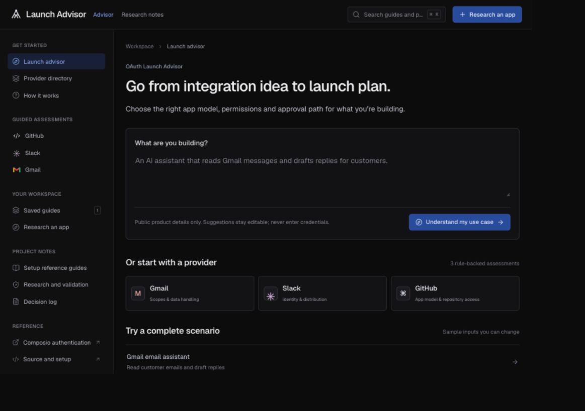

# OAuth Launch Advisor

**[Working experience](https://oauth-atlas.mossystar19.chatgpt.site) · [Source repository](https://github.com/infiniym/oauth-atlas)**

Describe an integration, confirm its requirements, and get an authentication architecture, permission map and launch checklist. The core works without API keys or signing into a provider.



## Try it

1. Enter “An AI assistant that reads Gmail messages and drafts replies for customers,” or choose Gmail, Slack or GitHub.
2. Review the suggested actions, then answer the contextual launch questions. “Not sure” stays an open question.
3. Generate the recommendation. Inspect **Why this recommendation?**, permissions, conditional approval dependencies, sources and the ordered checklist.
4. Edit Gmail to **send only** and regenerate. Restricted scopes and the restricted-data assessment dependency disappear; sensitive-scope guidance remains where applicable.
5. Try the Slack customer pilot or GitHub PR reviewer scenarios. A limited Slack pilot differs from commercial distribution; selected-repository background work leads to a GitHub App and a separate installation flow.
6. Copy, download Markdown, print or share the assessment. Sharing includes the description/answers, omits personal checkmarks, and recomputes with current rules. Markdown is the dated snapshot.
7. Search the **Provider directory**, or select **Research an app** for an unfamiliar provider.

## Coverage and evidence

| Coverage | What it means |
| --- | --- |
| 3 deep assessments | Gmail, Slack and GitHub, with source-backed rules for the listed actions and contexts |
| 1,694 catalog entries | Real toolkit names and Composio documentation links, captured 30 October 2026; catalog-only auth methods and managed availability are unverified |
| 4 setup reference guides | Earlier researched GitHub, Notion, Slack and Gmail guides, including setup observations and corrections |
| Live research drafts | Bounded public-source discovery/extraction for unfamiliar providers; incomplete, unreviewed and explicitly uncertain |

The intended 100 reviewed OAuth-guide library is **not complete**. Catalog breadth is not validated-guide breadth. [Open an existing hosted Linear research draft](https://oauth-atlas.mossystar19.chatgpt.site/?guide=draft-f9ad563b-6fd1-4644-9fdf-22237134d1f9).

The advisor checks official provider and Composio documentation. It has not registered apps, exchanged OAuth tokens, executed customer tools or obtained approvals. Previous setup observations reached public sign-in gates and inspected Google's client creation form without submission. The advisor adds planning depth, not an approval certification.

## Run locally

Node **22.13+**, npm. No API keys or cloud/provider accounts required.

```sh
npm ci
npm run build
node --import ./scripts/sites-env.mjs ./node_modules/wrangler/bin/wrangler.js d1 execute DB --local --config dist/server/wrangler.json --persist-to .wrangler/state --file drizzle/0000_orange_wallop.sql
npm run dev -- --port 5173
```

Open `http://localhost:5173`. Apply the migration once per fresh local database. Local and hosted D1 stores are separate. The advisor uses browser-local drafts and checkmarks; D1 stores public unfamiliar-provider research drafts and anonymous rate limits.

```sh
npm test
npm run typecheck
npm run build
```

## Deterministic rules versus AI

**Deterministic:** typed capability mappings, app-model selection, managed/custom suitability, permission classification, conditional dependencies, explanation IDs, checklist and export. Rules include source IDs and check dates. Tool restrictions are kept separate from provider grants. Managed OAuth availability never proves the necessary scope/token fit.

**Optional AI:** the server-side Responses structured-output adapter interprets the use-case description into known capabilities and unresolved questions. It cannot supply new scopes or approval rules. Model output is schema-validated and always editable. No key, invalid output, refusal, rate limit or timeout preserves the structured workflow with labeled local keyword suggestions.

**Live research:** the existing keyless reader performs real public network discovery and extraction, limited to four successful sources and a 58-second deadline. It is not an LLM policy interpreter. Missing timing, scope applicability and approvals remain unverified.

## Optional configuration

The public demo does not configure AI or authenticated Composio API access. Both adapters are tested with controlled responses; live credentialed calls remain unverified.

| Server-side binding | Behavior |
| --- | --- |
| `OPENAI_API_KEY` + `OPENAI_MODEL` | Enable optional intent interpretation. Choose a model in your account supporting Responses structured outputs; no model is silently selected. `store: false`; input is the developer's description and a constrained capability map. |
| `COMPOSIO_API_KEY` | Read `/api/v3.1/toolkits/{slug}` metadata for the selected assessment/Slackbot variant. Checks exact `composio_managed_auth_schemes`; does not infer granted scope coverage. |

For Vite/Cloudflare development, copy [.dev.vars.example](.dev.vars.example) to an ignored `.dev.vars` and provide server-side values using Cloudflare's local bindings facility. Configure equivalent Worker runtime secrets for hosting. Never put these values in client bundles or `NEXT_PUBLIC_` variables. Missing/failed metadata retains the dated docs snapshot instead of declaring managed OAuth unavailable. Optional AI has an anonymous limit of 20 requests per connection/hour; live research retains its limit of 10.

## Architecture

React + TypeScript on the existing Vinext/Vite stack, hosted as a Cloudflare Worker through Sites. No framework replacement or new account system.

| Module | Responsibility |
| --- | --- |
| `components/advisor.tsx` | Discovery, assessment, recommendation, checklist, edit/share/export |
| `lib/advisor/types.ts`, `providers.ts` | Typed requirements, capabilities, official sources and dated metadata |
| `lib/advisor/rules-engine.ts` | Compositional provider decisions with stable explanation IDs |
| `lib/advisor/assessment.ts` | Strict input validation, local intent suggestions, versioned share codec and progress keys |
| `lib/advisor/intent-parser.ts` | Optional server-only constrained AI adapter and fallback |
| `lib/advisor/metadata.ts` | Current Composio metadata adapter and conservative snapshot fallback |
| `app/api/advisor/` | Bounded interpretation and metadata endpoints; secrets stay server-side |
| `lib/advisor/export.ts` | Input context, rule results, sources and unchecked checklist as Markdown |
| `data/catalog.json` | Dated names/links snapshot; `scripts/sync-catalog.mjs` refreshes it from public docs |
| `lib/research.ts`, `app/api/research/` | Existing live source-reading flow and streamed progress |
| `data/guides.json`, `research/` | Original normalized reference guides and agent dossiers |

Refresh catalog metadata with `node scripts/sync-catalog.mjs`. It refuses incomplete extraction rather than replacing a valid snapshot. This is a maintainer command, not automated monitoring.

## Product and design decisions

The Composio [quickstart documentation](https://docs.composio.dev/docs/quickstart) is the primary reading reference: persistent grouped navigation, restrained headings, focused text and section links. Assessment forms use the same workspace. The earlier marketing-directory treatment is superseded. [DESIGN.md](DESIGN.md) records the observed reference and adaptations.

[The in-app decision log](https://oauth-atlas.mossystar19.chatgpt.site/?view=decisions) and [Markdown log](docs/DECISIONS.md) map 20 decisions to 15 requirements. D14 explains the design correction; D16–D20 explain the new advisor scope, deterministic/AI boundary, coverage, portable assessments and evaluation. Builds regenerate the log from `data/decisions.json`.

## Validation and limits

See [the validation notebook](docs/VALIDATION.md) for automated results, browser journeys, source corrections and verification limits.

Capability maps are deliberately scoped. Arbitrary special requirements are retained as open questions; not semantically interpreted. GitHub general conversation comments, branch writes and enterprise-wide APIs need additional mappings. Gmail exceptions depend on the complete architecture; calling a product internal or device-only is not sufficient proof. Slack identity, token scopes, channel membership and distribution-specific rate limits need representative tests.

Shared links are readable input bundles and may be long. They recompute with current rules. There is no private multi-user workspace or cross-device checklist. Research drafts are public and have no self-service moderation/deletion interface. Browser storage can be cleared.

The source reader uses bounded traversal, HTTPS/DNS checks and redirect revalidation; these are not resolver pinning or a security audit. Real OAuth flows, authenticated AI/Composio calls, provider approvals, complete browser/device coverage and developer comprehension studies remain outside the validated slice.

Next improvements: exercise credentialed adapters and real representative grants, add endpoint/tool permission coverage, validate draft guidance with developers, and expand the reviewed guide library before claiming 100-app depth.
